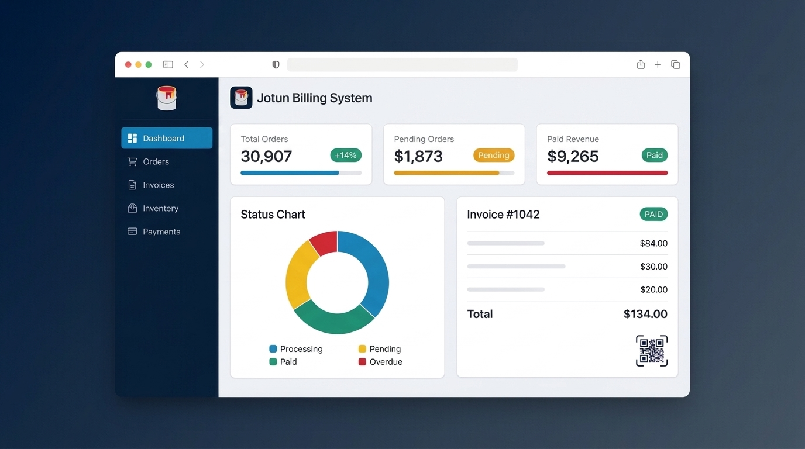

# Jotun Billing & Online Ordering System



A full-stack **Invoice, Inventory, Payment, and Customer Online Ordering** platform built for paint retail operations (**Marvel Decor / Jotun**), using **Node.js**, **Express**, **MySQL**, **Sequelize**, **Vue 3**, **Vite**, and **Bootstrap 5**.

- **Live Web App:** https://jotun-mysql-web.onrender.com *(Free-tier hosting; first API request may take ~30–60s on cold start)*
- **Customer Storefront:** https://jotun-mysql-web.onrender.com/shop
- **Technical Documentation:** [ER Diagram](./docs/ER_DIAGRAM.md) · [Security Controls](./docs/SECURITY.md) · [Testing Evidence](./docs/TESTING_EVIDENCE.md) · [User Manual](./docs/USER_MANUAL.md)

---

## Tech Stack

| Layer | Technologies |
| --- | --- |
| **Frontend** | Vue 3 (Composition API), Vite 6, Vue Router, Bootstrap 5, BootstrapVueNext, Axios, QRCode, SweetAlert2 |
| **Backend** | Node.js (ESM), Express 4, Sequelize ORM, MySQL2, JWT (`jsonwebtoken`), Bcrypt (`bcryptjs`), Helmet, Rate Limit |
| **Integrations** | Bakong KHQR (EMVCo CRC16-CCITT dynamic QR generation), Telegram Bot API |
| **Testing & Deploy** | Node.js Test Runner (`node --test` — 30 unit/integration tests), Render Blueprint (`render.yaml`), Vercel SPA config |

---

## Key Features

### Billing, Inventory & Payments
- **Atomic Invoice Numbering:** Sequential `INV-YYYY-00001` generation across Draft, Unpaid, Partially Paid, Paid, and Cancelled lifecycles.
- **Automated Stock Ledger:** Automatic inventory deduction when an invoice is confirmed and stock restoration upon cancellation, backed by `stock_movements` audit records.
- **Payment Tracking & Receipts:** Partial payment recording with receiver, timestamp, balance-due guardrails, printable receipts, and A4 Print / Save PDF invoice layouts.
- **Shareable Customer Invoices:** Tokenized public invoice links at `/public/invoices/:token`.
- **Bakong KHQR Dynamic QR:** Generates invoice-specific KHQR payment codes on active unpaid balances when enabled.

### Customer Online Ordering (`/shop`)
- **Public Product Catalogue:** Searchable paint catalogue with item codes, colour codes, shopping cart, and checkout workflow.
- **Audience-Isolated Auth:** Separate `customer_accounts` table and dedicated customer JWT audience isolated from admin authentication.
- **Controlled Stock Fulfillment:** Customer orders start as `pending`; staff verify stock in **Online Orders** and convert confirmed orders into invoices without premature stock deduction.

### Governance, Analytics & Backup
- **Role-Based Access Control (RBAC):** `owner`, `admin`, and `viewer` roles with enforced API and route guards.
- **Analytics & Exports:** Revenue trends, sales attribution, customer statements, debt aging, low-stock watchlists, and CSV exports.
- **Audit Logging & Soft Trash:** Recoverable soft-delete trash/restore for invoices, customers, and products, plus action audit trails.
- **Telegram Alerts & Automated Backups:** Telegram notifications for invoices, payment receipts, and overdue debt summaries, plus automated daily JSON snapshots with owner-only download and safe restore.

---

## Project Structure

```text
jotun-system/
├── backend/                # Express API, Sequelize models, services, repositories, and tests
│   ├── config/             # Auth, MySQL/Sequelize SSL, and Telegram config
│   ├── controllers/        # HTTP handlers for invoices, shop, orders, reports, auth
│   ├── middleware/         # Dual JWT auth, role checks, Helmet, login & API rate limits
│   ├── models/             # Normalized MySQL schema + local JSON dev/test fallback
│   ├── services/           # KHQR generator, Telegram sender, backup scheduler, migrations
│   └── tests/              # 30 automated tests (node --test)
├── frontend/               # Vue 3 + Vite SPA (Admin Portal & Public /shop Storefront)
├── docs/                   # ER Diagram, Security Controls, Testing Evidence, User Manual
└── render.yaml             # Render Blueprint (API + Static Web)
```

---

## Run Locally

1. **Database & Environment:** Create a MySQL database, copy `backend/.env.example` to `backend/.env`, and configure `DB_*` values. *(In development/test mode without MySQL configured, the backend falls back to local JSON storage; production always requires MySQL.)*
2. **Install and start the backend (`http://localhost:5000`):**

```bash
cd backend
npm install
npm run dev
```

3. **In another terminal, install and start the frontend (`http://localhost:5173`):**

```bash
cd frontend
npm install
npm run dev
```

### Generate Admin & JWT Secrets

```bash
cd backend
npm run hash-password
npm run generate-jwt-secret
```

Add the generated values to `backend/.env`:

```text
ADMIN_USERNAME=admin
ADMIN_PASSWORD_HASH=$2b$12$...
JWT_SECRET=long-random-secret
JWT_EXPIRES_IN=8h
```

The first successful environment-admin login provisions the initial `owner` account in the database, which can then manage `admin` and `viewer` accounts.

---

## Automated Tests

```bash
cd backend
npm test
```

Runs 30 automated unit and integration tests covering authentication, JWT audience isolation, invoice totals, stock movements, KHQR CRC16/EMVCo payloads, MySQL schema rules, backup/restore safety, and Telegram alert formatting.

---

## Deployment

### 1. Cloud MySQL
Provision a MySQL instance (e.g., Aiven or Railway), enable SSL (`DB_SSL=true`), and run schema sync once on a fresh database:

```bash
cd backend
npm run db:sync
```

Keep `DB_SYNC=false` in normal production startup.

### 2. Backend on Render
1. Import the repository as a Render Blueprint (`render.yaml`) or Web Service with Root Directory `backend`.
2. Configure production environment variables (`NODE_ENV=production`, `DB_*`, `CLIENT_URL`, `ADMIN_USERNAME`, `ADMIN_PASSWORD_HASH`, `JWT_SECRET`, and optional `TELEGRAM_*` / `KHQR_*`).
3. Verify `GET /api/health`.

### 3. Frontend (Render Static / Vercel)
- Root Directory: `frontend`
- Build Command: `npm ci && npm run build`
- Output Directory: `dist`
- Environment Variable: `VITE_API_URL=https://your-backend-url/api`
